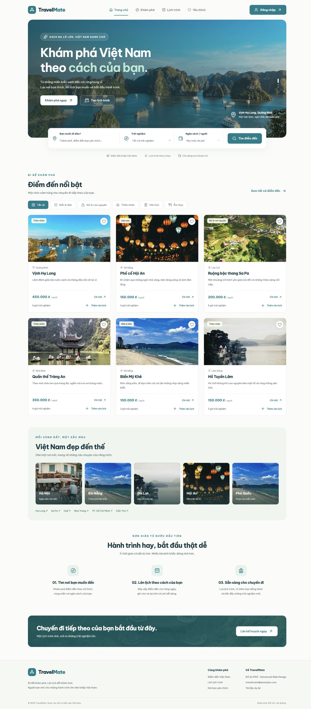

# TravelMate – Smart Travel Planner

**Hệ thống khám phá và lập kế hoạch du lịch thông minh** · Đồ án cuối kỳ EM3 – Advanced Web Design.

TravelMate giúp sinh viên và người trẻ tìm điểm đến tại Việt Nam, lưu nơi yêu thích, sắp xếp lịch từng ngày và dự tính chi phí cả chuyến đi. Giao diện chủ yếu bằng tiếng Việt, dùng tông Ocean & Tropical. Dùng HTML/CSS/JavaScript, Express và MongoDB; gợi ý lịch trình dựa trên quy tắc, không cần AI API.

**Website:** [travelmate-tj0k.onrender.com](https://travelmate-tj0k.onrender.com) · [Quản trị](https://travelmate-tj0k.onrender.com/admin) (đăng nhập admin).

Cập nhật trên `long_branch`, kiểm tra CI rồi merge vào `main`; Render tự deploy sau khi CI đạt. Xem [hướng dẫn triển khai](docs/DEPLOYMENT.md).

## 1. Chức năng

- **Trang chủ `/`**: ảnh cảnh quan, tìm kiếm, sáu địa điểm nổi bật lấy từ MongoDB, lọc trải nghiệm, vùng miền, hướng dẫn ba bước.
- **Khám phá `/explore`**: tìm tên, tỉnh/thành và tags; lọc địa phương, trải nghiệm, mức chi phí; sắp xếp; phân trang; chi tiết và Google Maps nhúng đồng bộ trang kết quả, chọn từng điểm và mở chỉ đường.
- **Lịch trình `/planner`**: tạo, xem, sửa, xóa; 1–7 ngày; thêm điểm vào ngày, sửa giờ/ghi chú/ước tính, chuyển ngày bằng nút, ghi chú từng ngày, sửa ngày có xác nhận; lưu MongoDB và mở lại sau refresh.
- **Yêu thích `/favorites`**: bộ sưu tập riêng từng tài khoản, tìm trong danh sách, bỏ lưu, thêm vào chuyến đi.
- **Đăng nhập/đăng ký**: dialog dùng chung trên bốn trang, email/password, phiên lưu trong MongoDB, menu người dùng, đăng xuất.
- **Quản trị `/admin`**: dashboard hoạt động, quản lý người dùng và khóa/mở khóa, xem toàn bộ lịch trình cùng người tạo, ngày, ngân sách và chi tiết hoạt động; quản lý điểm đến/khôi phục. Có tìm kiếm, bộ lọc và phân trang. Admin đăng nhập chuyển thẳng tới bảng điều khiển; HTML được bảo vệ ngoài thư mục public. Xem [hướng dẫn admin](docs/ADMIN.md).
- **Báo cáo điểm đến**: nút báo cáo trong từng chi tiết địa điểm; chọn thông tin cần sửa, mô tả và nguồn đối chiếu. Admin lọc, mở đúng địa điểm và trả lời; người gửi theo dõi riêng tại `/support`.

Các nâng cấp tiếp theo và phạm vi đã thống nhất nằm trong [kế hoạch nâng cấp](docs/ROADMAP.md); tách riêng với chức năng hiện có.

Giá seed là **ước tính minh họa cho hoạt động mỗi người**, không phải giá vé niêm yết và không phải tổng chi phí cả chuyến đi. Bạn bổ sung khách sạn, di chuyển, ăn uống trong phần Các khoản chi bổ sung. `null` nghĩa là chưa có ước tính; `0` chỉ dùng khi hoạt động thực sự miễn phí. Ngân sách thiếu giá được báo chưa đầy đủ.

## 2. Công nghệ và kiến trúc

- Node.js 22 trở lên (khuyến nghị Node LTS), Express 5, CommonJS.
- MongoDB Community Server, Mongoose, MongoDB Compass để quan sát dữ liệu.
- HTML5, CSS Grid/Flexbox, JavaScript ES6, Fetch, async/await, DOM, debounce.
- bcryptjs, express-session, connect-mongo, express-rate-limit.
- Google Maps dạng nhúng, không cần cấu hình API key; Lucide; Be Vietnam Pro với fallback hệ thống.
- Nodemon cho backend. Frontend thay đổi dùng refresh thủ công.

```text
Trình duyệt (4 trang HTML + JS thuần)
      │ Fetch cùng origin + cookie HttpOnly + CSRF header
      ▼
Express :3000 (tệp tĩnh, REST API, kiểm tra quyền)
      │ Mongoose / connect-mongo
      ▼
MongoDB :27017 / travelmate
      ▲
MongoDB Compass (ứng dụng quản lý, không phải database server)
```

Chỉ **một project, một Express server**, không có frontend server độc lập. Mọi thao tác lưu cá nhân nằm ở backend và MongoDB.

## 3. Cài đặt nhanh

```bash
npm ci
cp .env.example .env
node -e "console.log(require('crypto').randomBytes(48).toString('hex'))"
```

Chép chuỗi ngẫu nhiên vừa tạo vào `SESSION_SECRET` trong `.env`. Không dùng giá trị mẫu. File `.env` đã bị Git bỏ qua. Trên máy hiện tại `.env` đã được tạo với secret ngẫu nhiên riêng, không có mật khẩu admin.

```dotenv
PORT=3000
MONGO_URI=mongodb://127.0.0.1:27017/travelmate
SESSION_SECRET=chuoi_ngau_nhien_dai_it_nhat_32_ky_tu
NODE_ENV=development
```

Kiểm tra server:

```bash
mongosh "mongodb://127.0.0.1:27017/travelmate" --eval "db.adminCommand({ping:1})"
```

Khởi tạo dữ liệu và chạy:

```bash
npm run seed
npm run dev
```

Mở **http://localhost:3000**. Chạy thường bằng `npm start`. Đừng chạy `start` và `dev` đồng thời trên cùng cổng. Không mở HTML bằng `file://`.

Seed tạo **102 địa điểm tại 12 tỉnh/thành** trong phạm vi danh mục hiện có. Xem [danh mục, ảnh và cách cập nhật an toàn](docs/CATALOGUE.md). Script chỉ thêm slug chưa tồn tại, giữ nguyên chỉnh sửa của admin khi chạy lại. Không tự động seed mỗi lần khởi động.

### MongoDB Compass

**Website online lưu vào Atlas, còn `.env` trên máy đang dùng MongoDB local; hai nơi không tự đồng bộ.** Nếu kiểm tra hoạt động trên website online, kết nối Compass tới Project 0 → cluster `travelmate` → database `travelmate` trên Atlas. Xem [hướng dẫn kết nối và các collection cần xem](docs/DATABASE.md). Các bước dưới đây dành cho bản chạy localhost.

1. Mở Compass → Add new connection.
2. URI: `mongodb://127.0.0.1:27017` → Connect.
3. Chọn database **travelmate**.
4. Xem `users`, `destinations`, `favorites`, `itineraries`, `sessions`.
5. Thao tác trên website rồi bấm Refresh trong Compass để thấy thay đổi.

Collection chưa có dữ liệu có thể chỉ xuất hiện sau hành động đầu tiên. `users.passwordHash` là hash bcrypt, không phải mật khẩu gốc. `sessions` là dữ liệu nội bộ có mã phiên, không chia sẻ ảnh chứa nội dung phiên.

## 4. Khởi tạo quản trị viên an toàn

Admin dùng cùng hộp thoại đăng nhập. Đăng ký công khai luôn nhận role `user`, bỏ qua mọi `role` gửi từ trình duyệt.

Trên macOS/zsh, nhập mật khẩu ẩn vào biến môi trường:

```zsh
read -s 'ADMIN_PASSWORD?Mật khẩu admin (ít nhất 12 ký tự): '
echo
export ADMIN_PASSWORD
npm run seed:admin
unset ADMIN_PASSWORD
```

Script hỏi email và họ tên, sau đó tạo/cập nhật tài khoản tương ứng với role `admin`. Mật khẩu tối đa 72 byte UTF-8. Không truyền mật khẩu trong tham số dòng lệnh và không commit mật khẩu.
```

Có thể đặt `ADMIN_EMAIL` và `ADMIN_NAME` trong môi trường để bỏ qua câu hỏi, phù hợp kiểm thử tự động. Script không hardcode tài khoản hoặc mật khẩu. Chạy lại sẽ cập nhật mật khẩu tài khoản đã chọn; dùng đúng email mong muốn.

```

## 5. Cấu trúc thư mục

```text
server.js                 Khởi động, kết nối DB, đóng server
app.js                    Express, session, CSRF, routes, static
config/database.js        Kết nối Mongoose
models/                   User, Destination, Favorite, Itinerary
routes/                   Auth, discovery, favorites, itineraries, admin
middleware/               Xác thực, phân quyền, lỗi tập trung
utils/                    Xác thực dữ liệu, ngày, ngân sách
public/                   index/explore/planner/favorites.html
  css/                    style.css, responsive.css
  js/                     api, common, auth, home, explore, favorites, planner, admin
  images/                 Ảnh local, logo và fallback
views/admin.html          HTML quản trị được bảo vệ
scripts/                  seed.js, seedAdmin.js
data/destinations.js      Danh mục 102 điểm đến và nguồn ảnh
tests/                    Unit và integration với DB test riêng
docs/                     Nguồn dữ liệu, kiểm thử, kịch bản trình bày
```

## 6. Thiết kế cơ sở dữ liệu

| Collection | Trường chính | Ràng buộc |
| --- | --- | --- |
| users | fullName, email, passwordHash, role, isActive, lastLoginAt, lockedAt, lockReason, lockedBy, sessionVersion, timestamps | Email unique; hash và sessionVersion không select mặc định; API admin dùng allowlist |
| destinations | name, slug, province, region, category, description, imageUrl, coordinates, estimatedCostPerPersonVnd, duration, tags, isFeatured, isActive | Slug unique; tiền nguyên ≥ 0 hoặc null; tọa độ tùy chọn |
| favorites | userId, destinationId, createdAt | Compound unique `(userId, destinationId)` |
| itineraries | userId, title, startDate, endDate, travelers, budgetLimitVnd, notes, expenses, days, sharedAt, shareTokenHash, timestamps | API cá nhân kiểm tra chủ sở hữu; API admin xem toàn bộ sau kiểm tra role |
| activities | actorId, actorName, action, targetId, targetLabel, detail, createdAt | Chỉ admin đọc; TTL 90 ngày |
| sessions | session, expires | Do connect-mongo quản lý, TTL tự dọn |

```text
users 1 ───── n itineraries
                 └─ days[]
                     ├─ date, notes
                     └─ items[] ───── 1 destinations
users 1 ───── n favorites n ───────── 1 destinations
sessions ───── userId trong nội dung phiên
```

Mỗi item lưu `destinationId`, `visitTime`, `note`, `customCostPerPersonVnd`, `order`. Ngày lưu dưới dạng chuỗi `YYYY-MM-DD`; phép cộng ngày dùng UTC nên không lệch ngày theo múi giờ. Thứ tự array là thứ tự hoạt động, backend gán lại `order` khi lưu.

Giới hạn mỗi hoạt động/người là 1 tỷ VND, ngân sách là 1.000 tỷ VND; cùng giới hạn số người và hoạt động, phép tính tổng vẫn nằm trong miền số nguyên chính xác của JavaScript.

Không lưu dư tổng tiền trong document. Khi đọc, backend tính:

```text
Tổng hoạt động = Σ (customCost ?? destinationCost) × travelers
Tổng khoản chi = Σ amountVnd × (scope == person ? travelers : 1)
Tổng chuyến đi = tổng hoạt động + tổng khoản chi
Còn lại = budgetLimitVnd − tổng chuyến đi
```

Giá điểm đến cập nhật sẽ được phản ánh khi đọc lại lịch trình. Để chốt một ước tính cụ thể, nhập override cho item. Điểm đến bị ẩn vẫn tồn tại và được populate trong lịch sử, không thể thêm mới vào lịch trình khác.

## 7. REST API

JSON cùng origin. Các response lỗi có `{ "message": "Thông báo tiếng Việt" }`.

| Method | Route | Quyền / nội dung |
| --- | --- | --- |
| GET | /api/auth/csrf | Lấy CSRF token, khởi tạo phiên ẩn danh |
| POST | /api/auth/register | fullName, email, password, confirmPassword |
| POST | /api/auth/login | email, password |
| POST | /api/auth/logout | Đăng nhập; hủy session và cookie |
| GET | /api/auth/me | user an toàn hoặc null |
| GET | /api/destinations | Chỉ active; q, province, category, budget, sort, page, limit, featured |
| GET | /api/destinations/:id | Chi tiết active |
| GET | /api/favorites | Tài khoản hiện tại |
| POST | /api/favorites | destinationId; idempotent, có unique index |
| DELETE | /api/favorites/:destinationId | Bỏ yêu thích của chính mình |
| GET, POST | /api/itineraries | Danh sách của mình / tạo lịch trình |
| GET, PUT, DELETE | /api/itineraries/:id | Chỉ chủ sở hữu |
| GET | /api/admin/stats | Admin; số liệu, hoạt động 7 ngày, thành viên/lịch trình mới, điểm được lên kế hoạch |
| GET | /api/admin/users | Admin; tìm tên/email, lọc vai trò/trạng thái, phân trang, số lịch trình/yêu thích |
| GET | /api/admin/users/:id | Admin; hồ sơ và lịch trình gần đây |
| PATCH | /api/admin/users/:id/status | Admin; khóa có lý do / mở khóa, thu hồi phiên cũ; bảo vệ tài khoản admin |
| GET | /api/admin/itineraries | Admin; toàn bộ lịch trình, người tạo, lọc ngày/trạng thái/tài khoản, phân trang |
| GET | /api/admin/itineraries/:id | Admin; ngày, hoạt động, ghi chú và ngân sách |
| GET, POST | /api/admin/destinations | Admin; danh sách / tạo |
| PUT | /api/admin/destinations/:id | Admin; cập nhật toàn bộ trường được phép |
| DELETE | /api/admin/destinations/:id | Admin; **soft delete** `isActive=false` |
| PATCH | /api/admin/destinations/:id/restore | Admin; `isActive=true` |

Danh sách trả `{items,total,page,pages,provinces}`. `limit` mặc định 9, tối đa 100. `budget=low|medium|high`: dưới 200.000; từ 200.000 đến 500.000; trên 500.000 VND. Giá null không lọt vào nhóm giá thấp. `sort=featured|name|costAsc|costDesc`. Admin có thêm `status=active|inactive` và được thấy cả điểm đã ẩn.

PUT lịch trình nhận toàn bộ cấu trúc hợp lệ:

```json
{
  "title": "Ba ngày Đà Nẵng",
  "startDate": "2026-11-10",
  "endDate": "2026-11-12",
  "travelers": 2,
  "budgetLimitVnd": 3000000,
  "notes": "Mang theo máy ảnh",
  "days": [
    { "date": "2026-11-10", "notes": "", "items": [] },
    { "date": "2026-11-11", "notes": "", "items": [] },
    { "date": "2026-11-12", "notes": "", "items": [] }
  ]
}
```

Nếu đổi ngày làm mất hoạt động ở ngày bị xóa, backend trả 409 trừ khi có `confirmDateRemoval: true`. Frontend hiển thị xác nhận trước khi tạo lại cấu trúc ngày. Trong editor, thay đổi chưa lưu có nhãn rõ ràng và cảnh báo khi rời trang; bấm **Lưu lịch trình** để ghi MongoDB.

Mã trạng thái: 200 thành công; 201 tạo mới; 400 dữ liệu sai; 401 chưa đăng nhập; 403 không đủ quyền hoặc CSRF sai; 404 không tìm thấy/không sở hữu; 409 trùng dữ liệu hoặc cần xác nhận; 429 quá số lần đăng nhập; 500 lỗi nội bộ; 503 MongoDB ngắt kết nối.

## 8. Bảo mật dễ giải thích

- bcryptjs salt rounds 12. Không trả `passwordHash` trong API.
- express-session lưu phiên trong MongoDB; cookie `travelmate.sid` là HttpOnly, SameSite=Lax, thời hạn 7 ngày; Secure khi `NODE_ENV=production` và HTTPS.
- Tạo lại session ID và CSRF token sau login/register để chống session fixation.
- CSRF token ngẫu nhiên trong session, gửi trong `X-CSRF-Token` cho mọi POST/PUT/PATCH/DELETE, kể cả login; kiểm tra Origin khi có. `api.js` tự xin token trước mutation.
- Login/register giới hạn 30 lần / 15 phút / IP. Production chỉ cấu hình `trust proxy=1` khi có đúng một reverse proxy tin cậy.
- Backend chọn trường hợp lệ, kiểm tra email, ngày, số người, tiền nguyên, ObjectId, dữ liệu admin. Không nhận role hoặc userId tùy ý.
- API lịch trình cá nhân dùng đồng thời `_id` và `userId`; tài khoản khác nhận 404. Các API admin riêng mới được xem toàn bộ sau kiểm tra role. Khóa tài khoản chặn đăng nhập, tăng sessionVersion để cookie cũ mất hiệu lực, bảo toàn lịch trình/yêu thích.
- Nội dung người dùng dùng textContent hoặc được escape trước template DOM. URL ảnh chỉ cho http/https hoặc ảnh local. CSP chặn script inline, frame, object và form tới origin khác.
- Secret chỉ ở `.env` hoặc môi trường. Không dùng JWT và không lưu dữ liệu cá nhân trong localStorage.

## 9. Kiểm thử

MongoDB Server cần đang chạy:

```bash
npm test
npm run test:integration
```

Unit test kiểm tra ngày, giới hạn bảy ngày, dữ liệu, tiền thiếu/null, override bằng 0, chống trùng hoạt động. Integration test khởi động Express trên cổng ngẫu nhiên, dùng Fetch và cookie thật, database mới `travelmate_test_<pid>_<random>`, sau đó chỉ xóa database test đó. Không xóa database `travelmate`.

Test không dùng mock MongoDB. Nếu MongoDB không có, test integration thất bại với lỗi kết nối thay vì báo thành công giả. Có thể cấu hình `TEST_MONGO_BASE_URI` (chỉ host, ví dụ `mongodb://127.0.0.1:27017`) nếu khác mặc định.

Xem [báo cáo kiểm thử](docs/TESTING.md) và [kịch bản thuyết trình](docs/DEMO.md). Không đồng nhất test API với việc đã test mọi thao tác trên trình duyệt.

## 10. Sự cố thường gặp và giới hạn

- `ECONNREFUSED 127.0.0.1:27017`: MongoDB Server chưa chạy; mở Compass không tự bật Server.
- `EADDRINUSE :3000`: đã có server chạy; dừng tiến trình cũ hoặc đổi `PORT` trong `.env`.
- Lỗi SESSION_SECRET: tạo chuỗi ngẫu nhiên tối thiểu 32 ký tự, không dùng placeholder.
- Lỗi 403 CSRF sau khi phiên đổi: refresh trang rồi thử lại; backend không bỏ qua bảo vệ này.
- Nodemon chỉ theo dõi file backend. Chỉnh HTML/CSS/JS trong public phải refresh trình duyệt.
- Google Maps cần Internet. Bản nhúng hiện dùng không cần cấu hình API key; nút mở Google Maps và chỉ đường luôn có sẵn. Icons phục vụ local; ảnh có fallback SVG khi hỏng.
- Chỉ 3 địa điểm seed có tọa độ đối chiếu; còn lại null. Google Maps tìm theo tên và tỉnh/thành khi thiếu tọa độ; không tự lưu kết quả tìm kiếm thành tọa độ xác minh.
- Một số ảnh minh họa được tái sử dụng. Mô tả/chi phí là dữ liệu học tập. Xem [nguồn ảnh và tọa độ](docs/ASSETS.md).
- Danh sách chọn điểm trong planner hiện tải tối đa 100 địa điểm, đủ 32 điểm mẫu; có thể thêm phân trang khi dữ liệu lớn hơn.
- Không có reset mật khẩu qua email, export lịch trình, lưu ảnh upload hoặc cộng tác nhiều người. Không triển khai cloud theo phạm vi đề bài.
- `npm audit` hiện cảnh báo ba mục trong chuỗi dev `nodemon → chokidar → braces` ([advisory chưa có bản vá](https://github.com/advisories/GHSA-vfj7-8cjw-p6xm)). Không downgrade Nodemon về bản cũ chỉ để ẩn cảnh báo. Production dùng `npm start`, không chạy Nodemon và có thể cài `npm ci --omit=dev`.

## 11. Hướng mở rộng

Sau đồ án có thể bổ sung export PDF, phân trang picker, cập nhật giá từ nguồn được cấp quyền, reset mật khẩu và kiểm soát phiên bản lịch trình. Không cần các tính năng này để demo phạm vi hiện tại.

## 12. Ảnh giao diện đã kiểm tra



Xem thêm [Khám phá và Google Maps](docs/map-google-desktop.jpg), [planner mobile](docs/planner-mobile.jpg), [toàn bộ lịch trình trong admin](docs/admin-all-itineraries.jpg), [dashboard mới](docs/admin-complete-overview.jpg).

## 13. Khu quản trị hệ thống

Admin có layout riêng trong `views/admin.html`, CSS `public/css/admin.css`, JavaScript điều phối và module `admin-people.js`. Sidebar gồm Tổng quan, Người dùng, Lịch trình, Điểm đến và Điểm đã ẩn. Mục Chất lượng dữ liệu cũ được thay bằng Người dùng.

Dashboard lấy số liệu, biểu đồ 7 ngày, thành viên mới và lịch trình mới từ MongoDB. Người dùng có hồ sơ và khóa/mở khóa có lý do; toàn bộ lịch trình xem được cùng người tạo, ngày, hoạt động và ngân sách. Bộ lọc được lưu trong URL, có phân trang và nút Làm mới. Các màn chính không tràn ngang tại 375/768/1024/1440px; bảng cuộn trong khung trên màn hình hẹp.

Xem [hướng dẫn admin và API](docs/ADMIN.md), [kết quả kiểm thử](docs/TESTING.md). Google Maps dạng nhúng giữ theo yêu cầu; [chi tiết tích hợp](docs/MAP_SOURCE.md).

## 11. Tự deploy và các nâng cấp

Xem [hướng dẫn triển khai Render + Atlas](docs/DEPLOYMENT.md). CI chạy syntax check và integration test MongoDB riêng. `render.yaml` dùng nhánh `main` và chỉ tự deploy sau khi CI đạt.

- Ngân sách gồm hoạt động, lưu trú, di chuyển, ăn uống và phát sinh; khoản chi áp dụng cho cả chuyến hoặc mỗi người. Tối đa 100 khoản chi. Tổng và bảng phân loại được tính cùng một module ở client/server.
- Điểm đến có địa chỉ, giờ mở cửa, lưu ý giá, URL nguồn và ngày kiểm tra. Không tự suy diễn dữ liệu thiếu. Chưa có nguồn thì hiển thị rõ cần đối chiếu. Admin chỉnh sửa ngay trong mục Điểm đến.
- Admin có Nhật ký hoạt động và tùy chọn tự cập nhật mỗi 30 giây khi tab hiển thị, hoãn cập nhật bảng trong lúc thao tác. Đây là polling, không phải WebSocket.
- Chủ lịch trình bật/đổi/thu hồi liên kết chỉ xem. Token ngẫu nhiên 256 bit, chỉ hash SHA-256 được lưu; link không lộ danh tính chủ tài khoản. Ghi chú và ngân sách được chia sẻ sau khi người dùng bật; tài khoản khóa hoặc lịch trình bị xóa làm link không mở được.
- In / Lưu PDF dùng bản đã lưu, trang in tối ưu A4 và hộp thoại in của trình duyệt. Người nhận có thể giữ bản PDF ngay cả sau khi link bị thu hồi.
- Gợi ý lịch trình là quy tắc trên dữ liệu điểm đến hiện có: cùng một tỉnh/thành, ưu tiên sở thích và giá đã biết, tối đa 3 điểm và khoảng 6 giờ tham quan/ngày, không lặp điểm. Giá chưa biết được cảnh báo, ngân sách bằng 0 không mang nghĩa vô hạn. Chưa tính tuyến đường, giờ mở cửa và thời gian di chuyển thực tế. Xem trước, xác nhận thay hoạt động cũ, kiểm tra rồi lưu; API gợi ý không tự sửa lịch trình.

API bổ sung:

| Method | Route | Nội dung |
| --- | --- | --- |
| GET | /healthz | 200 khi MongoDB đã kết nối; 503 khi chưa sẵn sàng |
| GET | /api/admin/activity | Chỉ admin; group=user/itinerary/destination, page, limit, after cursor |
| POST | /api/itineraries/suggestions | Đăng nhập; province, categories, startDate, endDate, travelers, budgetLimitVnd, expenses |
| POST | /api/itineraries/:id/share | Chủ sở hữu; tạo token mới và vô hiệu link cũ |
| DELETE | /api/itineraries/:id/share | Chủ sở hữu; thu hồi link |
| GET | /api/shared-itineraries/:token | Dữ liệu chỉ xem qua token, không trả userId/email/hash |
| GET | /share/:token | Trang xem chia sẻ, noindex, no-referrer, no-store |
| GET | /trip-print/:id | Trang in yêu cầu đăng nhập, API kiểm tra chủ sở hữu |

## Cộng tác, chi tiêu thực tế và hỗ trợ thành viên

- **Chi tiêu nhóm:** Trong lịch trình, thêm tên thành viên chia tiền, ghi người đã trả, người cùng chia và hoàn trả đã diễn ra. Số dư/gợi ý hoàn trả tính bằng VND nguyên; dự toán và thực tế được trình bày riêng. Tên người chia tiền không bắt buộc có tài khoản. Các thay đổi chỉ lên máy chủ khi bấm **Lưu thay đổi**.
- **Cộng tác:** Chủ chuyến đi tạo lời mời theo đúng email, chọn người chỉnh sửa/chỉ xem, rồi sao chép liên kết gửi riêng. Liên kết có hạn 7 ngày và dùng một lần. Chủ có thể đổi quyền, thu hồi hoặc hủy lời mời; cộng tác viên có thể rời chuyến đi. Người xem không sửa, gửi trao đổi hoặc xóa chuyến đi. Chủ/người chỉnh sửa có bình luận và đề xuất; đề xuất không tự thay hoạt động. Cơ chế phiên bản chặn hai người âm thầm ghi đè khi cùng lưu; dùng **Tải bản mới nhất** sau khi giữ lại nội dung cần thiết.
- **Thời tiết:** Open-Meteo, tối đa 16 ngày từ hôm nay, tại điểm đầu tiên có dữ liệu của mỗi ngày. Ưu tiên tọa độ điểm đến; nếu dùng địa danh khu vực phải khớp tỉnh/thành và có nhãn tham khảo. Thiếu dữ liệu hoặc ngoài khoảng dự báo sẽ có thông báo riêng. Không tính tuyến đường trả phí.
- **Ngoại tuyến:** Khi có mạng và đăng nhập, bấm **Lưu ngoại tuyến** trong chuyến đi, sau đó mở `/offline` để đọc. Chỉ lưu bản chụp lịch trình đã chọn vào IndexedDB, không cache API hay trang admin/chia sẻ/lời mời. Có nút cập nhật và xóa bản lưu. Nội dung ngoại tuyến có thể cũ, cần mạng để kiểm tra quyền và lấy bản mới. Bản trên thiết bị bị xóa khi đăng xuất/hết idle; nếu trình duyệt đã đóng, kiểm tra và dọn ở lần mở kế tiếp. Không dùng thiết bị chung để lưu nội dung riêng tư.
- **Phản hồi:** Thành viên gửi và theo dõi phản hồi tại `/support`. Admin có hàng đợi lọc theo trạng thái, bộ đếm cần xử lý trên tổng quan, trả lời và lịch sử cập nhật. Trả lời hiển thị trong website; không tự sửa điểm đến và không tự gửi email.
- **Tài khoản:** `/account` sửa tên, đổi mật khẩu và thu hồi phiên khác. Email không đổi trực tiếp vì cần xác minh. Quên mật khẩu dùng Brevo miễn phí; xem [cấu hình email](docs/EMAIL.md). Chưa có cấu hình thì dịch vụ email chưa kích hoạt.

### Phiên đăng nhập khi không hoạt động

Người dùng tự đăng xuất sau **5 phút**, quản trị viên sau **10 phút** không thao tác. Cảnh báo trước khoảng 30 giây; gõ phím, di chuột hoặc cuộn trang đang hiển thị sẽ ghi nhận hoạt động. Các lần admin tự cập nhật/poll không gia hạn phiên. Máy chủ kiểm tra độc lập, kể cả khi tắt JavaScript. Tab đang mở đồng bộ hoạt động/đăng xuất cùng phiên; tab ẩn hoặc thiết bị ngủ kiểm tra lại khi quay về. Dữ liệu chưa lưu của lịch trình được giữ tạm trong RAM của tab khi hết idle, chỉ khôi phục nếu đăng nhập lại đúng tài khoản và còn quyền truy cập. Tải lại/đóng tab sẽ mất bản nháp RAM. Đăng xuất chủ động sẽ bỏ bản nháp và xóa bản ngoại tuyến.

Liên kết chia sẻ công khai vẫn chỉ xem lịch trình/dự toán, không công khai danh sách cộng tác, sổ chi thực tế hoặc thông tin tài khoản. Bản in riêng và admin hiển thị chi tiêu thực tế cho người có quyền.
