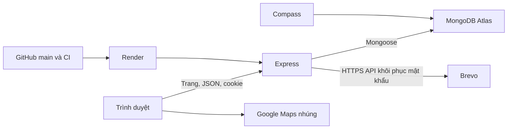
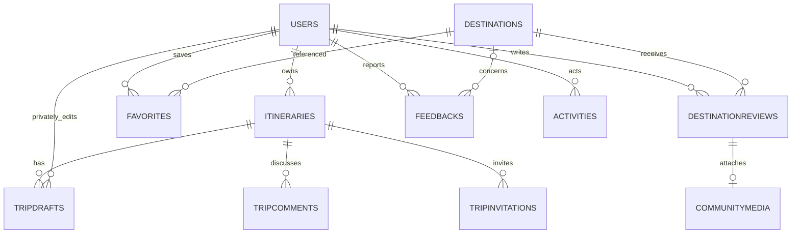

# Kiến trúc TravelMate

Frontend HTML/CSS/JavaScript và Express cùng một origin, cookie HttpOnly và CSRF cho các yêu cầu ghi. MongoDB Atlas lưu dữ liệu website online; MongoDB local độc lập dùng khi phát triển. Compass là ứng dụng xem/quản lý database.

## Quan hệ dữ liệu chính

`days/items`, cộng tác viên, các khoản chi, sổ chi và `planHistory` nằm nhúng trong lịch trình. Tham chiếu `days.items.destinationId` trỏ đến điểm đến. Lịch sử kế hoạch cập nhật cùng document bằng optimistic concurrency để không mất phiên bản khi hai người lưu.

`destinations.editorial` lưu bản nháp, trạng thái, phiên bản biên tập và 15 snapshot trước. Không được select mặc định trong API công khai. Xuất bản thay nội dung và ghi lịch sử trong một cập nhật document có điều kiện, kiểm tra phiên bản biên tập lẫn phiên bản nội dung.

## Collection và thời hạn

| Collection | Dữ liệu / kiểm soát |
| --- | --- |
| `users` | Tài khoản, role, trạng thái khóa và sở thích; hash/sessionVersion không public |
| `sessions` | Phiên server, idle 5/10 phút; polling/đọc không gia hạn |
| `destinations` | Nội dung công khai, bản nháp và lịch sử biên tập riêng admin |
| `itineraries` | Kế hoạch, quyền nhóm, chi phí và lịch sử 15 bản |
| `tripdrafts` | Nháp riêng user/trip, unique compound index, TTL 7 ngày |
| `favorites` | Unique user/destination |
| `destinationreviews` | Unique user/destination, trạng thái duyệt, phiên bản và metadata ảnh |
| `communitymedia` | Binary JPEG đã xử lý; kiểm tra quyền ở API trước khi trả ảnh |
| `mediaquotas` | Bộ đếm dung lượng toàn kho và theo tài khoản |
| `feedbacks` | Báo cáo thông tin, điểm đến nếu có và lịch sử trả lời |
| `tripcomments` / `tripinvitations` | Trao đổi nhóm, lời mời đúng email và token hash |
| `activities` | Nhật ký admin, TTL 90 ngày |
| `passwordresets` | Token khôi phục hash, dùng một lần trong 15 phút |

Thao tác đang có hiệu lực luôn kiểm tra hạn tại ứng dụng; TTL MongoDB dọn nền, không phải đồng hồ hết hạn chính xác từng giây. Đọc ảnh không công khai kiểm tra lại sessionVersion, trạng thái tài khoản và quyền sở hữu/admin.

## Triển khai và kiểm thử

`long_branch` → CI (cú pháp + test/MongoDB riêng) → `main` → CI → Render tự deploy sau checks. `/healthz` phản ánh kết nối database. Không có job seed/reset database trong build/start.

Kiểm thử dùng database tên ngẫu nhiên, tách khỏi production và tự dọn. Kiểm thử frontend bổ sung cho xung đột nháp và phản hồi đến muộn sau đổi tài khoản. Chi tiết kết quả theo từng đợt trong `TESTING.md`, thao tác người dùng/admin trong `UPGRADES.md` và `DEMO.md`.
